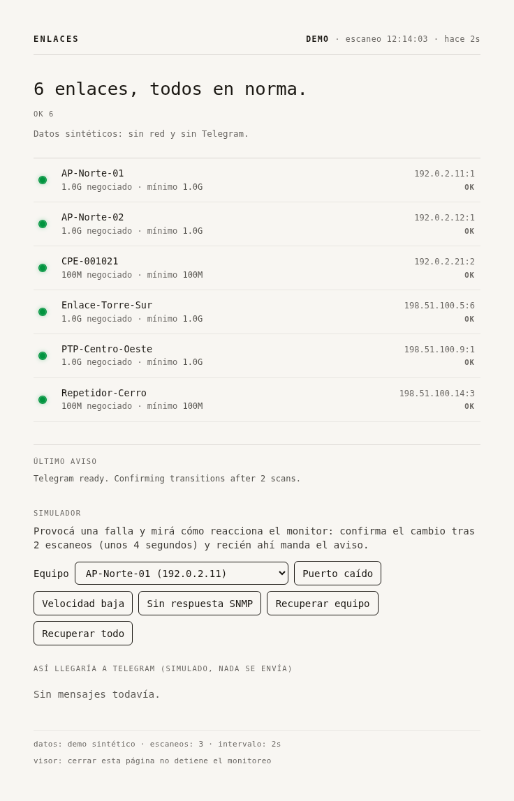
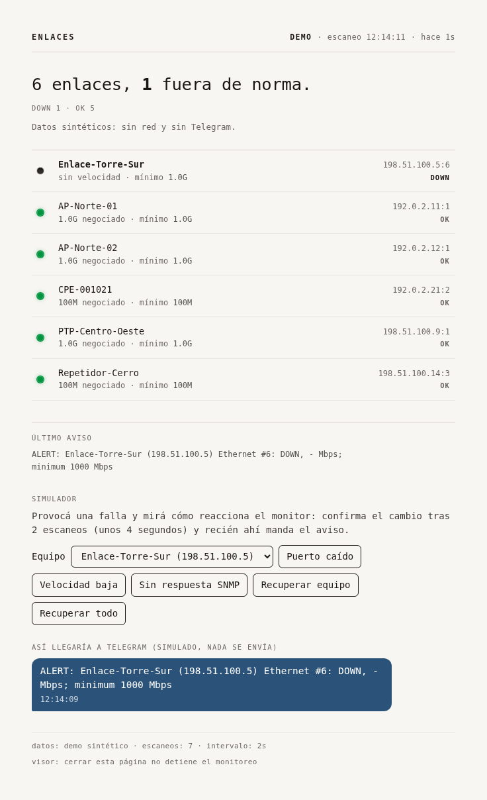

# Monitor de enlaces Ethernet

Un programa chico en Python: consultas SNMP, dashboards de terminal opcionales, un panel web local opcional y alertas por Telegram. Sin base de datos. Mide la velocidad Ethernet negociada, no el caudal de tráfico.

## Probalo ahora — sin credenciales ni red

Con las dependencias del paso 1 instaladas:

```bash
.venv/bin/python dashboard.py --demo
```

El dashboard dibuja una tabla en vivo desde un monitor demo en segundo plano: nombre, IP, puerto, velocidad negociada, mínimo configurado y estado, los peores enlaces primero. Teclas: **q** para salir, **s** para detener el monitor, **r** para refrescar, **o** para alternar el orden inventario/peores primero; seleccioná una fila para ver su detalle. Cerrar el dashboard nunca detiene el monitoreo ni las alertas de Telegram; volvé a correrlo para reconectarte. Los datos demo pasan por OK, velocidad baja, puerto caído, sin respuesta y desconocido cada 3 segundos; nunca contactan equipos ni Telegram.

Para un snapshot imprimible en vez de una pantalla completa:

```bash
.venv/bin/python dashboard.py --demo --once
```

El visor curses de `monitor.py` no necesita dependencias y sigue funcionando:

```bash
python3 monitor.py --demo
```

Usá **q** para cerrar ese visor y las **flechas** o **j/k** para desplazarte. El monitoreo sigue en un proceso aparte. Corré el mismo comando para reconectarte. Sin terminal interactiva el comando imprime el último snapshot y sale.

```bash
python3 monitor.py --demo --status  # PID and completed scan count
python3 monitor.py --demo --stop    # explicitly stop the demo monitor
```

## Panel web

**[Probá la demo interactiva en el navegador](https://frankirova.github.io/ethernet-link-monitor/)**: simulá la caída de un equipo y mirá el aviso que se enviaría. Datos ficticios, sin backend.

`python3 web.py --demo` abre el panel en el navegador con datos sintéticos (detalles en [WEB.md](WEB.md)). Los enlaces con problemas suben arriba y el resumen dice cuántos están fuera de norma.



Cuando un enlace cambia de estado, el monitor espera dos escaneos seguidos antes de avisar por Telegram, para no alertar por una falla de un solo instante. Así se ve una caída de puerto ya confirmada, con el aviso que se enviaría:



## Preparar el monitoreo real

### 1. Instalá las dependencias

Python 3.10+ en Linux/macOS, con soporte de curses en la terminal para el visor de `monitor.py`. `requirements.txt` fija `pysnmp` para SNMP y `textual` + `rich` para `dashboard.py`:

```bash
uv venv .venv
uv pip install --python .venv/bin/python -r requirements.txt
```

Sin uv: usá `python3 -m venv .venv` y `.venv/bin/python -m pip install -r requirements.txt`.

### 2. Configurá las credenciales en privado

Creá `.env` al lado de `monitor.py` con un editor privado y después dale permisos `600` (`chmod 600 .env`). Poné tus propios valores, por ejemplo:

```text
SNMP_COMMUNITY=your-read-only-community
TELEGRAM_BOT_TOKEN=your-bot-token
TELEGRAM_CHAT_ID=your-chat-id
```

El descubrimiento y el monitoreo reales cargan este archivo automáticamente; las variables de entorno ya definidas tienen prioridad. Si el archivo no está, todo sigue funcionando solo con variables de entorno. Tiene que ser un archivo regular tuyo, no un symlink, sin permisos de grupo ni de otros, y de 65536 bytes como máximo. Solo se importan las credenciales que necesita la operación elegida. El descubrimiento necesita solo `SNMP_COMMUNITY`; el monitoreo además carga los nombres de comunidad que figuran en `hosts.csv`. Pará y volvé a arrancar un monitor que esté corriendo para aplicar los cambios.

El formato soportado es UTF-8, líneas en blanco, comentarios `#` de línea completa y `KEY=value` con comillas simples o dobles opcionales y balanceadas alrededor de todo el valor. Los espacios de los extremos se recortan. Un `#` dentro de la línea es literal; no hay escapes y una comilla igual no puede aparecer dentro de su valor entrecomillado. Los valores son literales: no se ejecuta shell, ni sourcing, ni interpolación, ni sustitución de comandos, ni expansión de variables. No es una implementación completa de dotenv.

Alternativa: en Bash, cargá las credenciales sin mostrarlas en pantalla ni dejarlas en el historial del shell:

```bash
read -rsp 'Read-only SNMP community: ' SNMP_COMMUNITY; echo
read -rsp 'Telegram bot token: ' TELEGRAM_BOT_TOKEN; echo
read -rp 'Telegram chat ID: ' TELEGRAM_CHAT_ID
export SNMP_COMMUNITY TELEGRAM_BOT_TOKEN TELEGRAM_CHAT_ID
```

Creá el bot con el BotFather de Telegram y empezá una conversación con él (o agregalo al grupo de destino). Pasá el ID de ese chat. El programa no descubre IDs de chat ni manda un mensaje de arranque.

Las comunidades SNMPv2c viajan sin cifrar. Usá una comunidad de **solo lectura**, restringí UDP/161 a la máquina de monitoreo y usá una red de gestión confiable o una VPN. SNMPv3 no está implementado en esta primera versión. No pegues credenciales en el chat, no las pongas en el CSV y no las commitees.

Cada host se consulta primero con SNMPv2c y, si no contesta, con SNMPv1; la versión que respondió queda recordada por el resto de la corrida. Los firmwares AirOS viejos suelen contestar solo SNMPv1, así que no hace falta configuración extra. Se usa la misma comunidad de solo lectura para las dos.

### 3. Confirmá cada puerto Ethernet y su mínimo

`hosts.csv` es configuración local y no se commitea: el repositorio trae `hosts.example.csv` con el mismo encabezado y filas ficticias. Contiene los **19 nombres que coinciden con PTP**, sin distinguir mayúsculas, importados de tu inventario. Incluye Ubiquiti, Cambium y MikroTik. Solo se monitorean los hosts listados; el estado online/offline viejo del inventario se ignora.

`min_mbps` viene preconfigurado con la velocidad nominal del puerto cableado de cada modelo — 1000 para airFiber 5XHD, AF60/AF60-LR, LHG 60/60G y GigaBeam LR, 100 para Force300, variantes de PowerBeam 5AC y LiteBeam 5AC — y queda editable fila por fila. `ifindex` se completa solo donde el puerto se verificó por SNMP; el monitoreo real se niega a arrancar hasta que todas las filas tengan uno. No des por sentado que la velocidad negociada actual es el mínimo que querés.

Descubrí los índices de las interfaces Ethernet en un equipo:

```bash
.venv/bin/python monitor.py --discover 192.0.2.10
```

Esto hace consultas SNMP de solo lectura a esa IP, devuelve `ifindex` y descripción, y no manda ningún mensaje de Telegram. Emparejá el puerto físico que buscás con la UI del equipo. Un resultado vacío significa que no se anunció ninguna interfaz Ethernet, no que el puerto esté sano. Los equipos que informan mal la velocidad por IF-MIB necesitan validación aparte; no se intenta ningún fallback por SSH.

Comportamiento medido en estos enlaces: AirOS 8 (Force300) expone el puerto cableado como `LAN interface 1` (índice 6) y pone los Mbps en el campo de bits de `ifSpeed`, cosa que el monitor corrige prefiriendo `ifHighSpeed`; MikroTik expone `ether1` (índice 2); airFiber 5XHD informa su `eth0` física como caída con 0 Mbps mientras la interfaz de radio `ath0` informa la tasa real; los enlaces de 60 GHz (AF60/AF60-LR) exponen `eth0` en un índice que depende del firmware, así que leelo desde `--discover` en vez de suponerlo. Los hosts que no contestan ni SNMPv1 ni SNMPv2c tienen el agente apagado o usan otra comunidad; dale a cada uno su propia variable de entorno y poné su nombre en `community_env`.

Copiá `hosts.example.csv` a `hosts.csv` y editalo, conservando el encabezado. Solo como ejemplo — los índices y los mínimos hay que verificarlos:

```csv
nombre,ip,modelo,zona,ifindex,min_mbps,community_env
Example link,192.0.2.1,AF60,North,2,1000,SNMP_COMMUNITY
Manual link,192.0.2.2,M5,South,1,100,SNMP_COMMUNITY
```

Agregá cualquier host extra como fila nueva, tenga o no PTP en el nombre. Una misma IP puede tener varios puertos monitoreados con índices distintos. Para otra comunidad, definí una variable de entorno aparte y poné **su nombre**, no su valor, en `community_env`. El descubrimiento usa `SNMP_COMMUNITY`; asignale el valor que corresponda de forma temporal cuando descubras otro equipo.

Para importar otro inventario sin pisar la lista actual:

```bash
python3 monitor.py --import-csv inventory.csv --output new-hosts.csv
```

### 4. Arrancá

```bash
.venv/bin/python dashboard.py
```

El dashboard arranca un monitor en segundo plano o se adjunta al que ya está corriendo, y etiqueta el dato como LIVE o DEMO según la identidad del propio monitor, no según sus propios flags. Muestra nombre, IP, puerto, Mbps negociados, mínimo configurado y estado, más la cuenta por estado, los últimos avisos y un panel de detalle para la fila seleccionada. Un snapshot cuyo último escaneo completado es más viejo que el intervalo del monitor más 20 segundos (mínimo 30) se marca STALE, y un monitor que no está corriendo se marca DISCONNECTED; ninguno de los dos implica un enlace sano. Cerrar la terminal, apretar **q** o Ctrl+C cierra solo el visor; las consultas y Telegram siguen mientras el proceso del monitor esté vivo. Apretar **s** en el dashboard detiene el monitor explícitamente, igual que `--stop`.

Sin Textual, `monitor.py` abre su visor curses:

```bash
.venv/bin/python monitor.py
```

Cerrar la terminal, apretar q o Ctrl+C cierra solo el visor; las consultas y Telegram siguen mientras el proceso del monitor esté vivo.

```bash
.venv/bin/python monitor.py --status
.venv/bin/python monitor.py --stop
```

Usá la misma selección de `--hosts` y `--demo` para status o stop. `--runtime-dir DIR` elige un directorio privado, solo para tu usuario, para el control local; usá un directorio aparte para una instancia aparte. Una instancia que está corriendo rechaza otra ruta de hosts, otro modo demo/live u otro intervalo en vez de cambiar la configuración en silencio. Pará y volvé a arrancar para aplicar cambios, incluidos los del CSV o los de las credenciales. Status y stop no piden credenciales y nunca arrancan un monitor. Un visor desconectado o viejo no implica un enlace sano.

Para una máquina que corre desatendida bajo un supervisor que ya existe:

```bash
.venv/bin/python monitor.py --owner
```

`--owner` corre el monitor en primer plano, publica el snapshot que leen `web.py`, `dashboard.py` y `--status`, y toma el lock de monitor único, así que un segundo arranque se rechaza en vez de duplicar las alertas de Telegram en silencio. Parar el proceso detiene el monitoreo: el ciclo de vida lo maneja el supervisor. Pasale las credenciales al supervisor de forma privada.

`--headless` es el otro modo en primer plano y **no** es intercambiable: imprime un bloque por escaneo completado a stdout y no publica ningún snapshot, así que ningún visor ni `--status` puede verlo, y no toma ningún lock. Usalo solo donde lo único que querés es la salida de log pelada; usá `--owner` siempre que otra cosa tenga que leer el estado.

`deploy/` trae dos units de `systemd --user` listos para `--owner` y para el panel web. Este repositorio no instala ningún servicio de sistema. Cerrar un visor es distinto de apagar la máquina, reiniciarla o que el proceso del monitor se caiga: eso detiene el monitoreo salvo que armes un supervisor adecuado. Corré un solo monitor por lista de hosts para evitar notificaciones duplicadas.

Mientras alguna fila todavía no tenga `ifindex`, `hosts.csv` se niega a arrancar a propósito. `hosts.activos.csv` — también local, también fuera de git — tiene solo las filas ya medidas, así que puede correr hoy; regeneralo cuando completes más filas y pasá el mismo flag `--hosts` a status y stop:

```bash
.venv/bin/python monitor.py --hosts hosts.activos.csv
```

## Panel web local

`web.py` dibuja el mismo monitor como página en tu navegador. Es un visor con el mismo contrato que `dashboard.py`: se adjunta al monitor que está corriendo o arranca uno, y cerrar la página, el proceso o Ctrl+C nunca detiene el monitoreo ni Telegram.

No agrega ninguna dependencia. `web.py` usa solo la biblioteca estándar, así que el demo funciona sin el `.venv` y sin `textual`, `rich` ni `pysnmp`:

```bash
python3 web.py --demo
```

Imprime la URL que tomó, por defecto `http://127.0.0.1:8765/`. El demo muestra datos sintéticos con intervalo de 3 segundos y nunca contacta equipos ni Telegram. El monitoreo real sigue necesitando las dependencias del paso 1, porque el monitor es el que necesita `pysnmp`.

### Qué contesta el panel

De arriba abajo: la palabra `enlaces`, un badge con el modo del monitor y, cuando el dato no es fresco, la frescura al lado, la hora del último escaneo completado y su antigüedad; una frase con el veredicto; un desglose por estado; una nota cuando hay algo que explicar; una fila por enlace con un LED, nombre, `ip:ifindex`, velocidad negociada, mínimo configurado y la palabra de estado; el último aviso tal cual; y un pie con el archivo de origen del dato, la cantidad de escaneos, el intervalo y el pid. Los peores van primero.

Un enlace que nadie pudo leer nunca se reporta como sano. `DOWN` y `LOW` cuentan como fuera de norma, `UNREACHABLE`, `UNKNOWN` y `PENDING` cuentan como sin dato, y solo `OK` cuenta como sano. Las palabras de estado se muestran tal cual porque Telegram y los dashboards de terminal usan las mismas.

El LED es la metáfora: verde para un enlace gigabit sano, ámbar para un enlace a 100 Mbps (una diferencia real de velocidad negociada), un zócalo oscuro y apagado para `DOWN`, un anillo hueco para `UNREACHABLE`/`UNKNOWN`. El color nunca es la única señal — la palabra de estado siempre está.

Hacé clic, tocá o activá una fila con el teclado para desplegar su detalle en línea: estado, velocidad, mínimo, puerto, ip y motivo. La fila queda marcada mientras el detalle está abierto.

La página sigue la preferencia clara/oscura del sistema operativo y no tiene selector de tema. Para que el monitor y el panel sigan corriendo entre cierres de sesión y reinicios, mirá `deploy/`. Consulta cada 2 segundos y pausa las consultas mientras la pestaña está oculta. No carga ningún asset externo — ni fuentes de CDN ni fuentes de íconos — así que funciona en un sitio sin internet.

### Estados de la página

Cada estado se escribe en pantalla en vez de esconderse. El badge informa el modo del monitor y, cuando el dato no es fresco, la frescura al lado (`LIVE STALE`, `DEMO STARTING`); con el monitor caído no hay modo que informar y el badge dice solo `DISCONNECTED`. La frase del veredicto y la nota llevan la explicación.

| Estado | Significado |
| --- | --- |
| `LIVE` | Badge: el monitor al que está conectado no es el demo. |
| `DEMO` | Badge: el monitor al que está conectado es el demo. Datos sintéticos, sin red, sin Telegram. |
| `STARTING` | El monitor está vivo pero todavía no completó ningún escaneo. Se suma al badge. |
| `STALE` | El último escaneo completo es más viejo que el intervalo del monitor + 20 s (mínimo 30 s). Nunca implica enlaces sanos. Se suma al badge. |
| `OUTDATED` | El monitor que está corriendo es anterior a las filas por enlace y publica solo texto; paralo y arrancalo de nuevo. Se suma al badge. |
| `DISCONNECTED` | No hay monitor corriendo. El badge muestra solo esa palabra y la lista se vacía en vez de mostrar datos viejos. |

Cuando el servidor local deja de responder, el badge deja de repetir el último estado del monitor y pasa a `SIN SERVIDOR`, la página dice `No se pudo leer el panel`, y sigue reintentando cada 2 segundos. Cuando el dato no es confiable, la lista se atenúa y se desatura, porque el color no puede avalar un snapshot viejo.

Opciones: `--demo`, `--hosts FILE`, `--interval SECONDS`, `--runtime-dir DIR`, `--port PORT`. `--hosts` y `--interval` se usan solo cuando la página tiene que arrancar el monitor; `--port 0` elige un puerto libre y se imprime el puerto que tomó. Ver `python3 web.py --help`.

### Solo loopback

`web.py` escucha solo en `127.0.0.1`. No hay autenticación ni opción para ampliar el bind, así que para leerlo desde otra máquina, hacé un túnel en vez de ampliar el bind:

```bash
ssh -L 8765:127.0.0.1:8765 user@monitor-host
```

La superficie HTTP es la página más un único endpoint de solo lectura, `GET /api/snapshot`. Solo se responde GET: cualquier otro método, `OPTIONS` y `TRACE` incluidos, se rechaza con 405 y `Allow: GET`, y el rechazo va sin cuerpo. Sirve cuatro assets explícitos, nunca lista un directorio y nunca sirve un archivo por nombre pedido. Cada respuesta, rechazos incluidos, lleva `Cache-Control: no-store` y una Content-Security-Policy que no permite ningún origen externo. El snapshot expone el nombre del archivo de hosts, nunca su ruta absoluta.

No hay historial, ni gráficos, ni base de datos: el monitor no guarda nada, así que la página no inventa nada. Un snapshot viejo se muestra como viejo, no se interpola. La página solo lee — no puede detener el monitor.

## Comportamiento de las alertas

| Estado | Significado |
| --- | --- |
| OK | Puerto arriba, velocidad igual o mayor al mínimo |
| LOW | Puerto arriba, velocidad por debajo del mínimo |
| DOWN | SNMP informa down/lower-layer-down/not-present |
| UNREACHABLE | Sin respuesta SNMP; no se puede inferir el estado del puerto |
| UNKNOWN | Dato faltante o no soportado, interfaz inválida o error de protocolo |

- El mínimo 100 acepta 100 o 1000 Mbps; el mínimo 1000 rechaza 100 Mbps.
- Dos observaciones consecutivas que coinciden confirman una transición. Ahí se manda un mensaje de Telegram. Un OK confirmado más adelante manda una recuperación solo si la alarma se entregó con éxito.
- Una entrega fallida de Telegram se muestra localmente y se reintenta en los escaneos siguientes mientras la condición persista. Una ambigüedad de red igual puede duplicar un mensaje; no se promete entrega exactamente una vez.
- El dashboard muestra la última observación cruda; Telegram espera la confirmación.
- El sondeo es secuencial, acotado a 8 segundos por host. Los pedidos a Telegram tienen un timeout de 10 segundos. La pausa por defecto es de 60 segundos **después de un escaneo completo**, no un período de muestreo garantizado de 60 segundos. Los hosts lentos o inalcanzables alargan el ciclo.
- El estado vive en memoria: reiniciar resetea la confirmación y puede reenviar una alerta activa. Sin base de datos histórica, sin persistencia, sin supresión basada en topología y sin deduplicación a prueba de reinicios.

`--demo`, `--discover` y `--import-csv` son mutuamente excluyentes. `--output` se acepta solo con `--import-csv`; las combinaciones incompatibles salen con código 2 sin consultar equipos ni escribir archivos.

Opciones: `--hosts FILE`, `--interval SECONDS`, `--owner`, `--headless`, `--demo`, `--once`, `--status`, `--stop`, `--runtime-dir DIR`, `--discover IP`, `--import-csv FILE`, `--output FILE`. Ver `python3 monitor.py --help`.

Opciones del dashboard: `--demo`, `--hosts FILE`, `--interval SECONDS`, `--runtime-dir DIR`, `--once`. El dashboard se adjunta al monitor que esté corriendo, así que `--hosts` y `--interval` se usan solo cuando tiene que arrancar uno. `--once` imprime un snapshot y sale; si fue el que arrancó el monitor, lo vuelve a parar. Ver `python3 dashboard.py --help`.

Opciones del panel web: `--demo`, `--hosts FILE`, `--interval SECONDS`, `--runtime-dir DIR`, `--port PORT`. También se adjunta al monitor que esté corriendo, así que `--hosts` y `--interval` se usan solo cuando tiene que arrancar uno; `--port 0` elige un puerto libre. Siempre escucha en loopback y no tiene `--once`. Ver `python3 web.py --help`.

`--once` imprime un solo escaneo: sale 0 si está sano, 1 si algún host real está mal, 2 ante errores de arranque o de configuración. El demo sale 0. Un solo escaneo no puede confirmar una alerta, así que no manda mensajes. Ctrl+C o q sale 0.

## Verificación

```bash
.venv/bin/python -m unittest discover -s tests -v
```

Los tests usan observaciones sintéticas, Telegram mockeado y un simulador SNMP en loopback; no contactan equipos de producción ni Telegram. La compatibilidad real de modelos y firmwares, y la entrega de Telegram, hay que comprobarlas con tus credenciales antes de confiar en esto en producción.


## Cómo se construyó

Desarrollado con agentes de IA bajo mi dirección. Definí el problema, los requisitos, la arquitectura y los criterios de aceptación; revisé el código, lo probé y lo uso.
